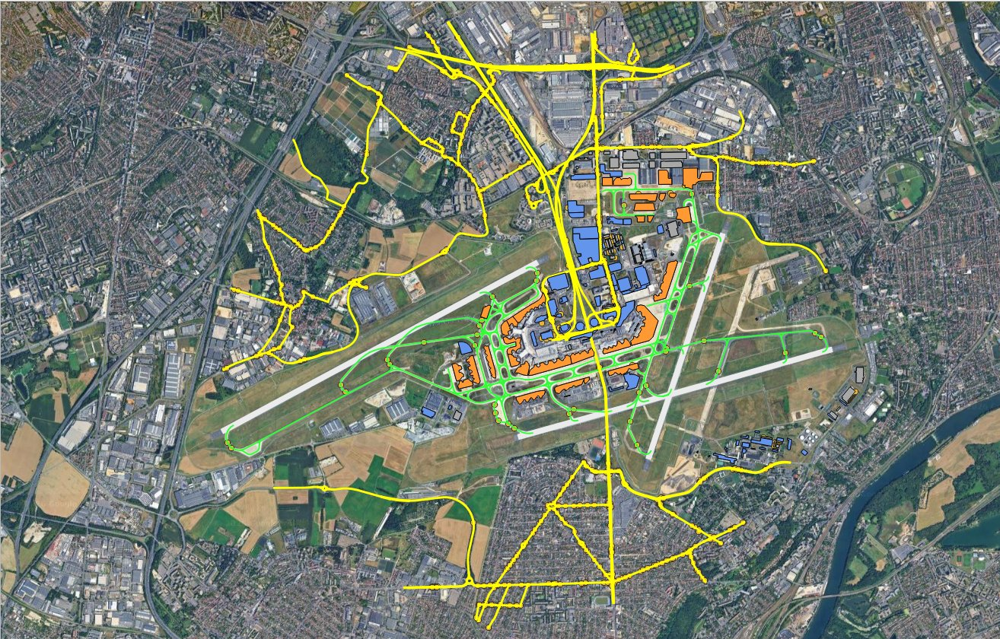
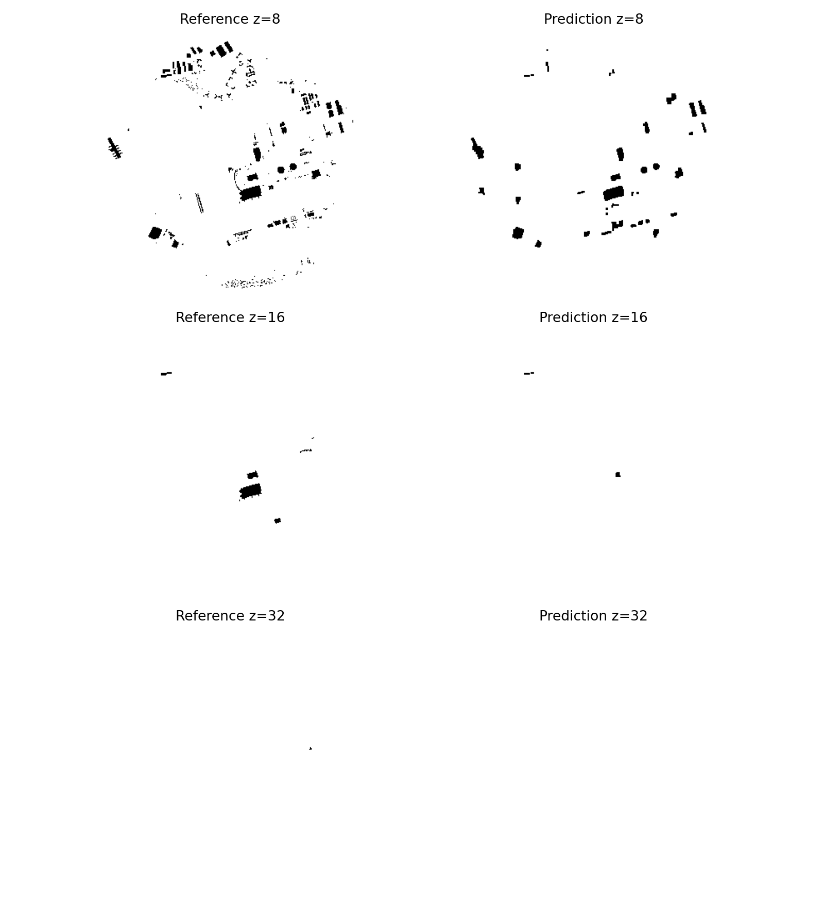
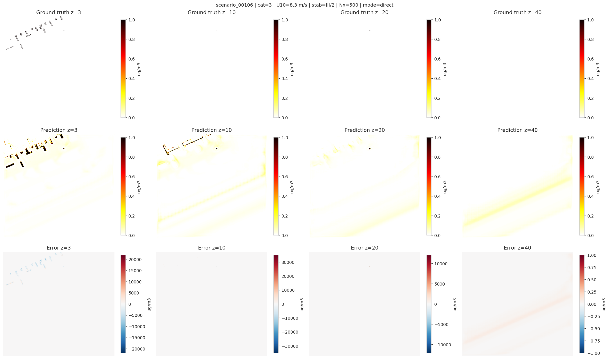

# Airport digital twin and NOx dispersion prediction

Two connected deep-learning experiments on Paris-Orly airport, done for the
"IA & Application" module at CY Tech (ING3, March to April 2026). Part 1 builds a 3D
model of the airport from OpenALAQS/QGIS and OpenStreetMap layers, fits a neural
signed-distance field to it (DeepSDF-style MLP with Fourier features) and turns the
field back into an obstacle mask for a wind solver. Part 2 trains a 3D U-Net to predict
the NOx concentration volume of an airport scenario from wind, geometry and emission
fields, on a 3 000-scenario dataset provided by the course. Part 1 gave a fragmented
reconstruction, which is why the project moved to Part 2 (`docs/changement_d_approche.md`).

## Layout

```
config.yaml        parameters of the geometry pipeline (Orly, sampling, model, training)
src/               one script per step: openalaqs_import, data_ingestion, prepare_runtime_config,
                   sdf_sampling, deepsdf_model, train, evaluate_reconstruction, visualize, generate_mask
notebooks/         deepsdf_airport_colab.ipynb (Part 1 on Colab), nox_dispersion_unet.ipynb (Part 2)
provided/          wind/dispersion solver, losses.py and dataset notes supplied by the course
results/           deepsdf/ and nox/: metrics, logs, figures and meshes of the final runs
docs/              report, slides, state of the art, subject, notes (French)
```

## Part 1: airport geometry and neural SDF

I built an OpenALAQS study of Orly in QGIS (buildings, runways, taxiways, aprons, gates,
and the surrounding roads through QuickOSM).



`data_ingestion.py` reads that study, falls back to a GeoJSON file or to an Overpass
query when it finds no buildings, extrudes each footprint (OSM height, `building:levels`
x 3.5 m, or 10 m by default) and exports the mesh. `sdf_sampling.py` draws 2.1 M points
(250 k on the surface, 1.6 M within 1.2 m of it, 250 k anywhere in the domain) and
computes their signed distance with trimesh, using the 2D footprints to fix the sign.
The network maps a normalised (x, y, z) through 8 Fourier frequencies into an 8-layer,
512-unit MLP with a skip connection (1.89 M parameters), trained with a clamped L1 loss
for 200 epochs on a T4 (Adam, lr 2e-4, cosine schedule, batch 16 384, 33 s per epoch).
Validation loss went from 0.695 to 0.139 (a constant-zero predictor gives 0.783). Every
20 epochs the model is also probed on a coarse grid; the checkpoint with the best
occupancy IoU (epoch 160) is evaluated below on the full 321 x 321 x 65 grid
(`results/deepsdf/reconstruction_metrics.json`).

| metric | value |
|---|---|
| occupancy IoU | 0.375 |
| precision / recall | 0.788 / 0.417 |
| Chamfer L1 / Hausdorff (approx.) | 123.7 m / 675 m |
| voxel accuracy | 0.995, but 99.3 % of the voxels are free space |



The terminals and the large hangars are there, but the field is fragmented: small
buildings vanish (recall 0.42) and the thresholded field had 2 415 connected components,
of which `evaluate_reconstruction.py` keeps the 42 grounded ones before writing the
`(1, 1, 65, 321, 321)` obstacle mask (only run through the wind solver as an integration test).

Something I found while cleaning up the repository: in the final run the importer read
0 features from the `.alaqs` study (`results/deepsdf/openalaqs_reference_layers.json`), so
the mesh actually came from 672 OSM footprints. SpatiaLite blobs carry the byte-order flag
in their header, not in front of the WKB payload, so `shapely.wkb.loads` failed on every
row and the exception was swallowed. The fix in `src/openalaqs_import.py` decodes all
1 107 Orly features (45 buildings, 3 runways, 168 taxiways, 113 parkings, 749 roads,
29 gates); the numbers above are still from the OSM-only run.

## Part 2: NOx dispersion with a 3D U-Net

The course provided `dataset_subset_3000.h5` (124 GB, not in this repo): 3 000 scenarios
of a Lagrangian dispersion simulation (1 h, 1 M particles) on grids of 140, 300 or 500
columns squared by 64 layers at 5 m x 5 m x 3 m. Each scenario has nine volumes: NOx
concentration (target), wind u/v/w, obstacle mask, obstacle SDF, GSE SDF, LTO SDF and
total emissions. The dataset notes say 5.6 % of the arrays are all zero; my own pass
found 422 scenarios (14 %) with no active particle.

The notebook streams the file, splits it 2 400 / 300 / 300 stratified on airport category
and stability class, and removes the zero-particle scenarios from the training split only
(2 072 left). The model is a 4-level 3D U-Net (base 32 channels, InstanceNorm, LeakyReLU,
Softplus output, 22.6 M parameters) with 7 input channels: the three wind components, the
three SDFs and the emissions. It trained for 200 epochs on an H100 in bf16 on
64 x 224 x 224 crops (batch 8, AdamW 3e-4 with cosine decay, about 4.5 min per epoch).
The loss is the course's physics-informed composite (boundary-weighted MSE, mass
conservation, solid-voxel penalty, total variation) plus two terms I added that weight
voxels above 10 and 50 ug/m3 far more than the background. Crops are centred on the plume
85 % of the time, and the checkpoint is chosen on the plume RMSE of 16 fixed full-volume
validation scenarios rather than on the global loss (`results/nox/figures/training_curves.png`).

Best epoch 163 (`results/nox/logs/report_summary.json`), evaluated on the 300 test
scenarios at full volume (`results/nox/logs/test_summary.json`):

| metric (test) | value |
|---|---|
| voxel accuracy on 6 concentration bins | 0.998 |
| weighted F1 / macro F1 | 0.999 / 0.211 |
| F1 per bin (0-10 / 10-50 / 50-100 / 100-200 / 200-500 / >500 ug/m3) | 0.999 / 0.000 / 0.000 / 0.000 / 0.012 / 0.251 |
| median per-scenario RMSE | 69.7 ug/m3 (110 on the 255 scenarios with a plume) |
| median per-scenario plume RMSE (voxels above 10 ug/m3) | 6 344 ug/m3 |



The model learned where plumes are and roughly how strong they are, and the selection
metric kept improving (plume RMSE 816 k at epoch 1, 151 k at epoch 2, 134 k at epoch 163).
It did not learn the intermediate bins, and it predicts a plume in scenarios that have none.

## Limitations

- Accuracy and weighted F1 prove nothing here: 1.819 of the 1.820 billion test voxels sit
  in the 0-10 bin. In my first runs I read a 0.9997 validation accuracy as success while
  the network predicted zero everywhere (`docs/nox_training_notes.md`). Macro F1 (0.21)
  and per-scenario medians are the honest numbers, and they are modest.
- Mean test errors are unusable: the 45 zero-particle test scenarios get large false
  plumes (mean RMSE 4.8e10 there against 4.4e3 elsewhere), a direct consequence of
  removing such scenarios from training. Per-scenario R2 is around 0.
- The 10-500 ug/m3 bins hold between 1 890 and 34 648 voxels in the whole test set, so
  their per-class F1 is mostly noise. Model selection relies on 16 validation scenarios.
- The course suggested a 2 M parameter budget and a mask-versus-SDF comparison of the
  geometry encoding. I went to 22.6 M parameters and only ran the SDF mode.
- Part 1 fits a single scene: the 3 % validation split measures fit quality, not
  generalisation, and there is no latent code, so it is a neural SDF of one airport
  rather than DeepSDF proper.

Next steps I would take: keep a controlled share of zero-particle scenarios in training or
gate the output on the emission field, predict log(1 + c) instead of c, rerun Part 1 with
the fixed importer, and train a 2 M parameter baseline in both mask and SDF modes.

## Running it

```bash
pip install -r requirements.txt
python src/data_ingestion.py --config config.yaml
python src/prepare_runtime_config.py --config config.yaml --output config_runtime.yaml
python src/sdf_sampling.py --config config_runtime.yaml
python src/train.py --config config_runtime.yaml
python src/evaluate_reconstruction.py --config config_runtime.yaml --checkpoint checkpoints/best_geometry.pt
python src/visualize.py --config config_runtime.yaml --checkpoint checkpoints/best_geometry.pt
python src/generate_mask.py --config config_runtime.yaml --checkpoint checkpoints/best_geometry.pt
```

`config.yaml` expects your OpenALAQS export at `data_sources/airport_study.alaqs` (set the
key to an empty string to use OSM footprints instead). Training needs a GPU; the Colab
notebook runs the same steps. Part 2 is `notebooks/nox_dispersion_unet.ipynb`; it expects
`data/dataset_subset_3000.h5` and `provided/losses.py`. Nothing was retrained for this
clean-up: all numbers and figures come from the April 2026 runs whose logs are in `results/`.

## Context

Individual project for the "IA & Application" module, CY Tech ING3 GIA B, March to April
2026, taught by Souhaila Arib. The NOx dataset, `losses.py` and the solvers in `provided/`
were supplied by Abdellahi Babah; the code in `src/`, the notebooks and the docs are my work.
