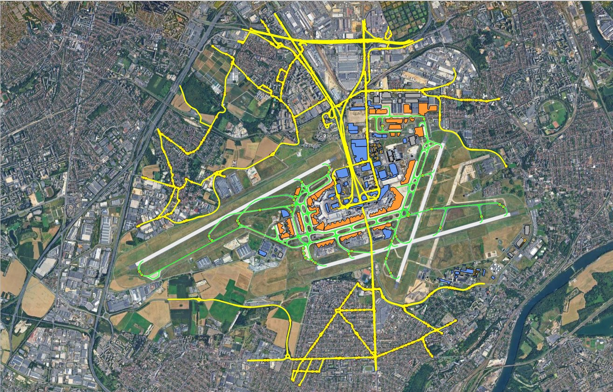
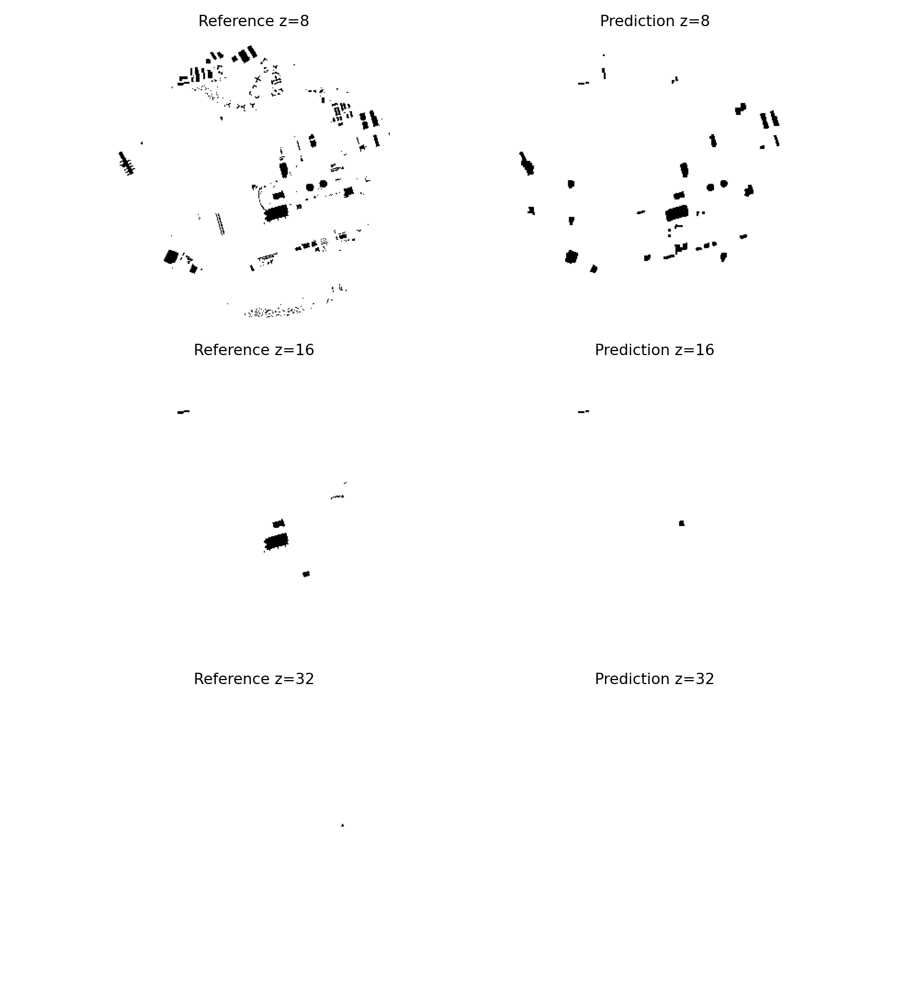
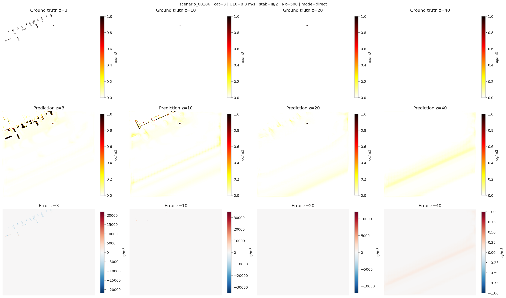

# Airport digital twin and NOx dispersion prediction

Two deep-learning experiments on Paris-Orly airport. The first fits a DeepSDF-style neural signed-distance field to a 3D model of the airport built from OpenALAQS, QGIS and OpenStreetMap layers. The second trains a 3D U-Net to predict the NOx concentration volume of an airport scenario from wind, geometry and emission fields.



## What it does

- Builds a mesh of the airport (buildings, runways, taxiways, aprons, gates, roads) from an OpenALAQS study, samples 2.1 M signed distances and fits a Fourier-feature MLP of 1.89 M parameters.
- Turns the field back into a 65 x 321 x 321 obstacle mask, tested in the course wind solver.
- Predicts NOx volumes with a 4-level 3D U-Net of 22.6 M parameters from seven input channels: three wind components, three signed-distance fields and the emissions.
- Trains on 3 000 simulated dispersion scenarios, 14% of them without any active particle.

## How it works

```
.alaqs + OSM  -> data_ingestion.py -> sdf_sampling.py -> train.py (clamped L1, 200 epochs, T4)
              -> evaluate_reconstruction.py, generate_mask.py on the epoch-160 checkpoint
dataset_subset_3000.h5 (124 GB) -> notebooks/nox_dispersion_unet.ipynb
              -> split 2 400 / 300 / 300, 200 epochs on an H100 (bf16, 64 x 224 x 224 crops)
              -> physics-informed loss with plume weighting, checkpoint on the validation plume RMSE
```

## Results

Geometry on the full 321 x 321 x 65 grid (`results/deepsdf/reconstruction_metrics.json`). NOx on the 300 test scenarios, best epoch 163 (`results/nox/logs/test_summary.json`).

| part | metric | value |
|---|---|---|
| geometry | occupancy IoU, precision / recall | 0.375, 0.788 / 0.417 |
| geometry | Chamfer L1 / Hausdorff (approx.) | 123.7 m / 675 m |
| geometry | voxel accuracy | 0.995, with 99.3% of voxels free |
| NOx | voxel accuracy on 6 bins, weighted F1 / macro F1 | 0.998, 0.999 / 0.211 |
| NOx | F1 per bin, 0-10 / 10-50 / 50-100 / 100-200 / 200-500 / >500 ug/m3 | 0.999 / 0.000 / 0.000 / 0.000 / 0.012 / 0.251 |
| NOx | median per-scenario RMSE, all / 255 with a plume / plume voxels | 69.7 / 110 / 6 344 ug/m3 |

The SDF keeps the terminals and hangars but drops the small buildings. The U-Net places the plumes but misses the intermediate bins, so the macro F1 stays low; 99.97% of the test voxels sit in the 0-10 bin, which makes voxel accuracy and weighted F1 meaningless.




## Run it

Python with `requirements.txt`, QGIS for the OpenALAQS export, a GPU for training.

```bash
pip install -r requirements.txt
python src/data_ingestion.py --config config.yaml
python src/prepare_runtime_config.py --config config.yaml --output config_runtime.yaml
python src/sdf_sampling.py --config config_runtime.yaml
python src/train.py --config config_runtime.yaml
python src/evaluate_reconstruction.py --config config_runtime.yaml --checkpoint checkpoints/best_geometry.pt
```

`notebooks/deepsdf_airport_colab.ipynb` runs the same steps on Colab. The NOx notebook needs `data/dataset_subset_3000.h5` (course data, not in the repo) and `provided/losses.py`.

## Limitations

- Mean test errors are unusable: the 45 zero-particle test scenarios, absent from training, get false plumes with a huge RMSE, and per-scenario R2 is around 0.
- The 10-500 ug/m3 bins hold few test voxels, so their F1 is mostly noise, and model selection rests on 16 validation scenarios.
- The SDF fits one scene without latent code, so its validation split measures fit, not generalisation. The published mesh comes from 672 OSM footprints, before the importer learned to decode SpatiaLite blobs (1 107 Orly features).

Individual project for the IA & Application module at CY Tech, ING3, March to April 2026, taught by Souhaila Arib. Abdellahi Babah supplied the NOx dataset, `losses.py` and the solvers in `provided/`; I wrote the rest. Report, slides and a note on why the work moved to the dispersion part are in French in `docs/`.
